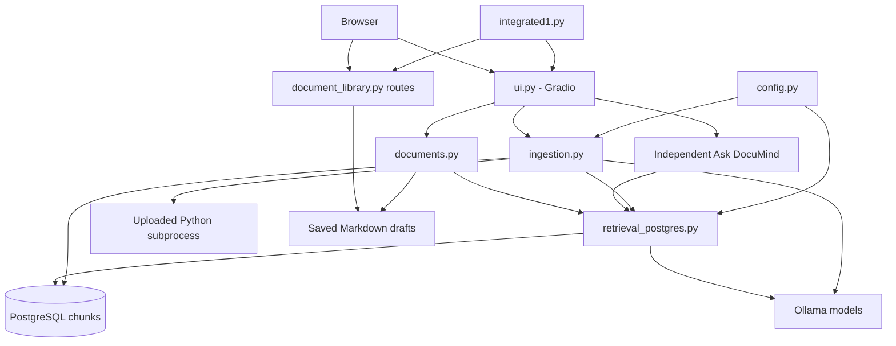

# DocuMind - Modular Code Documentation Application

DocuMind is a Python/Gradio application that indexes source code and uses local Ollama models to answer questions and generate documentation drafts. Drafts are saved as Markdown and displayed on separate HTML webpages.

This README describes the current `documind-feature_module` folder, including independent Ask DocuMind queries and bounded recovery from Ollama token-repetition errors.

> **Safety:** indexing currently executes uploaded Python files. Only process trusted code on restricted compute. The default launcher also requests a public Gradio share URL; it does not configure user authentication.

## Contents

1. [Quick start](#quick-start)
2. [Files and responsibilities](#files-and-responsibilities)
3. [Tools and concepts](#tools-and-concepts)
4. [Architecture](#architecture)
5. [Upload and index workflow](#upload-and-index-workflow)
6. [Independent Ask DocuMind](#independent-ask-documind)
7. [Generate documents and exceptions](#generate-documents-and-exceptions)
8. [Document webpages and storage](#document-webpages-and-storage)
9. [Models and inference settings](#models-and-inference-settings)
10. [Database and configuration](#database-and-configuration)
11. [Function map](#function-map)
12. [Testing](#testing)
13. [Troubleshooting](#troubleshooting)
14. [Security and known limitations](#security-and-known-limitations)
15. [Deployment and maintenance](#deployment-and-maintenance)

## Quick Start

### Prerequisites

- A Python environment with the application dependencies installed; prefer the existing tested VM environment.
- A running Ollama service, the `mxbai-embed-large` embedding model, and an appropriate chat model.
- A PostgreSQL database containing the compatible `documind_nprd.chunk_details` table.
- Writable upload/draft storage.
- `python3.12` available if the current uploaded-file execution behavior is retained.

Activate your existing environment, enter this application folder, and run:

```bash
python integrated1.py
```

The dashboard uses port `7861`:

```text
http://localhost:7861/             Main dashboard
http://localhost:7861/documents    Saved-document library
```

If the app runs on a VM, your laptop's `localhost` is not that VM. Use the approved reachable VM address, forwarded port, or share URL printed at startup.

No separate document-page server is required. Keep all application modules together; deploying only the launcher is insufficient.

### Dependencies

The application imports Gradio, NumPy, Ollama's Python client, psycopg2, pgvector's Python integration, Tree-sitter, the Tree-sitter Python grammar, and markdown-it-py. Document routes use Starlette through the server stack.

[requirements-html.txt](requirements-html.txt) declares the Markdown renderer dependency only. It is not a complete or pinned application dependency manifest.

To install that additional renderer dependency into the active environment:

```bash
python -m pip install -r requirements-html.txt
```

That does not install PostgreSQL, configure its table, start Ollama, or download models. Verify package compatibility in the deployment environment rather than upgrading native libraries blindly.

Check installed models:

```bash
ollama list
```

Example model-download commands, subject to machine resources and deployment policy:

```bash
ollama pull mxbai-embed-large
ollama pull qwen2.5-coder:7b
```

The second is an example chat model, not a requirement that every machine run a 7B model.

## Files and Responsibilities

| File | Purpose |
|---|---|
| [integrated1.py](integrated1.py) | Launcher: build the dashboard, register document routes, apply CSS, enable crash tracebacks, and start Gradio. |
| [ui.py](ui.py) | Main dashboard and optional retrieval-only dashboard, controls, CSS, state, progress, and event wiring. |
| [config.py](config.py) | Upload-directory selection and main PostgreSQL configuration. |
| [ingestion.py](ingestion.py) | Upload copying, file discovery, Tree-sitter chunks, embeddings, Python execution, database insertion, and processing summary. |
| [retrieval_postgres.py](retrieval_postgres.py) | Query embeddings, scoped similarity search, prompts, model selection, chat calls/retries, Ask handler, and retrieval CLI. |
| [documents.py](documents.py) | Architecture/exception requests, draft saving, timestamps, failed-response checks, and open-document results. |
| [document_library.py](document_library.py) | Markdown-to-HTML rendering, searchable library, individual-document routes, and offline HTML export. |
| [test_model_generation.py](test_model_generation.py) | Dependency-free tests with mocked services for retry behavior, draft-save guards, independent Ask, and UI wiring. |
| [requirements-html.txt](requirements-html.txt) | Markdown renderer requirement. |
| [readme.md](readme.md) | This application guide. |

Generated/cache directories are separate from source. `.gradio` and `__pycache__` are not application pipeline modules. The configured upload root may be outside this source folder.

## Tools and Concepts

| Term | Beginner explanation | Role here |
|---|---|---|
| UI | Fields, buttons, and results a person interacts with | Gradio dashboard |
| Backend | Processing performed on the server | Ingestion, retrieval, documents |
| Callback | Function called after an event | A button triggers a pipeline function |
| State | Values remembered across UI events | Uploaded project folder and indexing result |
| Module | A Python file with a focused responsibility | The separated source files above |
| LLM | Trained model that generates language | Explains retrieved source code |
| SLM/lightweight model | Smaller model using fewer resources | An option when a VM cannot run larger chat models efficiently |
| Ollama | Service and client API for serving models | Model listing, embedding, and chat |
| Parsing | Reading source according to its programming syntax | Tree-sitter builds a Python syntax tree |
| Chunking | Splitting code into searchable pieces | Function/class chunks and module fallback |
| Embedding | Numerical representation of text | Code and question search vectors |
| Vector | Ordered list of numbers | Stored embedding |
| Semantic search | Search based on meaning, not only exact words | Match question vectors to code vectors |
| Cosine distance | Measure of vector-direction difference | Lower distance ranks closer matches |
| Top-k | Maximum number of best-ranked matches | Five, six, or seven chunks in common flows |
| RAG | Retrieve relevant context, add it to a prompt, then generate | The retrieval-and-answer pipeline |
| Prompt | Instructions and context supplied to a model | System role plus source code and question |
| Token | Piece of text processed by a model | Input/output model units, not identical to characters |
| Context window | Limit on text a model can consider | Restricts supplied evidence and output |
| Inference | Running a trained model | Both embedding and chat generation |
| Temperature | Setting influencing response variability | Normally `0.1`; adjusted for repetition retry |
| Hallucination | Unsupported or incorrect generated claim | Still possible despite grounded prompts |
| PostgreSQL | Persistent database service | Code chunks, metadata, vectors |
| pgvector | PostgreSQL vector support | Native cosine-distance query when storage is compatible |
| NumPy | Numerical-array library | float32 vectors and fallback similarity calculations |
| psycopg2 | Python PostgreSQL driver | Connections, queries, bulk insertion |
| Markdown | Readable document format with headings and tables | Saved drafts |
| HTML/CSS | Webpage structure and styling | Document webpages and dashboard |
| Route | Server path selecting a response | `/documents` and document URLs |
| Transaction | Group of database changes committed together | Bulk ingestion commit/rollback |
| Environment variable | Configuration supplied outside source | Database settings and upload root |

### What RAG does and does not mean

```text
Preparation: code -> chunks -> embeddings -> database
Request: question -> embedding -> retrieve chunks -> prompt -> model answer
```

The model is not retrained by these calls. It does not automatically browse the repository: it sees only the selected context. Similarity is a ranking signal, not an answer-correctness probability.

LangChain and LangGraph are not used by the current implementation. The app calls Ollama and PostgreSQL directly. It is a fixed callback workflow, not an autonomous multi-agent system.

## Architecture



The modules run within one Python application; they are not separate custom API servers. PostgreSQL and Ollama are external services. Some processing functions still return Gradio updates/warnings, so separation is not complete UI-framework independence.

The launcher listens on all interfaces with `server_name="0.0.0.0"`, requests public sharing with `share=True`, and applies `DASHBOARD_CSS` through `launch()` for Gradio 6-style startup.

## Upload and Index Workflow

### User actions

1. Enter a project name.
2. Choose Files or Folder and select trusted input.
3. Click Upload Files.
4. Select the main workflow's model.
5. Click Process & Index Project.
6. Read the processing summary before generating documents.

Uploads enable the main model selector. Document generation remains gated by successful current-session indexing. Ask is independent and described separately below.

### Upload behavior

`process_upload()` validates the name, creates `<BASE_UPLOAD_FOLDER>/<project>`, and copies files with `shutil.copy2()`.

Blank names, exact `.`/`..`, slash/backslash characters, and absolute paths are rejected. Only each file's basename is retained, so identical filenames from different source subdirectories can collide. A later upload does not remove older unselected files from the project directory.

### Indexing behavior

1. Discover files recursively and read each as UTF-8 text.
2. Parse readable content with Tree-sitter's Python grammar.
3. Extract functions/classes at all nesting levels, including names, source text, and line ranges.
4. Use the whole nonblank file as a module chunk when no function/class chunks exist.
5. Embed eligible chunks one at a time using `mxbai-embed-large`.
6. Prepare rows named `<project>/<relative-file>`.
7. Execute each uploaded `.py` using `python3.12`, capturing output/errors with a 60-second subprocess timeout.
8. Bulk-insert prepared rows into `documind_nprd.chunk_details` and commit once.
9. Attempt a separate automatic overview through RAG using six chunks.
10. Return the indexing/overview summary and whether at least one chunk committed.

The Python execution happens during file processing, before the final database insert. Insertion page size is 100, but pages do not commit independently.

The summary includes elapsed seconds, files found, embedding model, resolved chat model, and indexing/overview status. Detailed reports and source text are printed on the server.

An overview failure does not undo previously committed chunks. The overview is attempted even after an indexing failure and can therefore find older project rows.

### Parser boundaries

- Tree-sitter is retained; runtime chunking is not replaced by Python `ast`.
- Every readable file is passed through the Python grammar, not only `.py` files. This is not a PDF/Word/general-language parser.
- A class and its methods can produce overlapping chunks.
- Module-level imports/assignments may not be indexed when definitions exist.
- Large definitions are not divided by a token budget.
- Parser `has_error` is logged, but does not automatically reject every recovered tree.
- A native parser segmentation fault is not caught by `except Exception`.

## Independent Ask DocuMind

Ask is available from startup with its own **Ask DocuMind Model** selector. It does not require new uploads or indexing to query existing database chunks.

### Explicit project in the prompt

```text
Project: sample
Explain how exceptions are handled.
```

Rules:

- `Project:` must be on the first non-whitespace line; put the question on subsequent lines.
- The header keyword is case-insensitive, but the project value preserves case.
- `sample` searches `file_name` prefixes beginning with `sample/`; `Sample` is a different stored prefix.
- An explicit header overrides the uploaded project stored in session state.
- The header is removed before question embedding and intent detection.
- No upload or re-indexing occurs for this request.
- Unknown projects yield the retrieval no-matches response; the query does not expand to all projects.
- Blank/path-like project names and questions missing after the header are rejected.

### Uploaded-project fallback

Without a `Project:` header, Ask uses the current uploaded project folder if available. Without either source of project scope, it asks for a project name.

Upload resets no longer disable Ask or reset its independent model selector. They still clear its displayed answer along with the upload workflow's results.

Ask searches indexed source-code chunks, not generated Markdown documents. Each question is independent; no conversational history is supplied to later requests.

### Find the stored project names

An authorized database operator can inspect prefixes without reading source content:

```sql
SELECT DISTINCT split_part(file_name, '/', 1) AS project_name
FROM documind_nprd.chunk_details
WHERE position('/' IN file_name) > 0
ORDER BY project_name;
```

Legacy rows without a project prefix will not match the current project-scoped convention.

## Generate Documents and Exceptions

Both main Generate actions remain part of the upload/index workflow.

| Action | Callback | Saved filename |
|---|---|---|
| Generate Document | `generate_project_document()` | `confluence_draft.md` |
| Generate Exceptions | `generate_exceptions_document()` | `exceptions_draft.md` |

The button first updates its box with Processing. A chained callback resolves the main selected model, retrieves seven project-scoped chunks, generates text, saves the draft, and returns its open link, actual model name, and elapsed time. Compact progress is scoped to the result box.

No-source responses and recognized `LLM Generation Error:` responses are not saved. A failed generation leaves previously saved drafts unchanged rather than replacing them with an error document.

### Prompt and quality limits

The standard prompt requests a technical specification with summary, workflow, components, decisions, and operations. It specifies **Architect: DocuMind** and **Status: Draft**, forbids invented personal names, and uses Not Available for other unknown roles. These are prompt instructions, not deterministic output validation or human approval.

Each retrieved chunk is capped at 1,800 characters in the prompt. This is not a full token-budget calculation; important code can be truncated.

**Known limitation:** both main generation actions pass `prompt_type="standard"`. The prompt builder also gives documentation keywords priority over exception mode. As a result, Generate Exceptions can receive the architecture template rather than the dedicated exception template. Complete exception coverage is not guaranteed.

Generated citations are not independently validated. The shared retrieval result contains source records, but main draft saving does not append a separately verified source inventory.

## Document Webpages and Storage

### Where information lives

| Information | Storage |
|---|---|
| Uploaded source files | `<BASE_UPLOAD_FOLDER>/<project>/` |
| Source chunks, locations, embeddings | PostgreSQL `documind_nprd.chunk_details` |
| Generated architecture/exception drafts | `<BASE_UPLOAD_FOLDER>/_confluence_drafts/<project>/` |
| Offline HTML library export | `<BASE_UPLOAD_FOLDER>/_confluence_drafts/index.html` |
| Selected uploaded folder and indexing flag | Gradio session state |

Example:

```text
/home/azureuser/proj-documind/test/repo/
    sample/
        example.py
    _confluence_drafts/
        sample/
            confluence_draft.md
            exceptions_draft.md
        index.html
```

The Markdown stores title, draft status, model, creation/update times, the request, and generated content. Repeated generation for one project/type overwrites that filename while retaining its recorded creation time. There is no version history.

### Routes

```text
/                              Dashboard
/documents                     Searchable document library
/documents/sample/confluence_draft.md   Individual rendered HTML document
```

The library scans drafts when requested, sorts by latest modification, and embeds data for browser-side search by project/title/filename. Refresh an existing library tab to see newly saved drafts.

Individual routes require a Markdown file within the configured draft root and reject missing/outside-root paths. Responses use `Cache-Control: no-store`.

Markdown rendering disables raw HTML and images. Mermaid code blocks are not automatically rendered as diagrams by this page renderer. These controls do not provide user authorization.

The UI has no download controls, but files remain on the server and the launcher permits file serving from the draft root. Removing a visible download is not an access-control boundary.

Saving a draft also exports an offline library using temporary-file replacement. An export warning does not necessarily mean the Markdown save failed. The live library route reads Markdown directly.

### Clearing generated documents

There is currently no cleanup button. Stop active generation and confirm the configured draft root before any manual cleanup. Removing only `_confluence_drafts` contents clears generated documents/export; it does not clear uploads or database rows. Refresh the library afterward.

Preview saved files on the VM without deleting anything:

```bash
find /home/azureuser/proj-documind/test/repo/_confluence_drafts -type f
```

Use the actual configured root if different. Back up drafts before permanent deletion. Do not remove the whole upload root when only documents should be cleared.

## Models and Inference Settings

### Embedding model

Code and query embeddings use `mxbai-embed-large`. Its usual vector size is 1,024. The actual database storage/adaptation must match that output, and code/question embeddings must use compatible models, not merely equal vector lengths.

### Chat-model labels

Main generation and independent Ask offer labels such as:

```text
Qwen2.5-Coder-7B-Instruct
Phi-3.5-min-instruct
Deepseek-Coder-6.7BInstruct
```

`map_ollama_model()` searches installed non-embedding models using the UI label's prefix. If no match is found, it selects the first installed non-embedding model. If listing fails or no candidate is present, it falls back to `qwen2.5:0.5b`.

This is not exact version/size selection. Read the resolved model in completion results. The fallback is not downloaded automatically.

### Repetition recovery

| Attempt | Conditions | Options |
|---|---|---|
| Normal request | Every chat call | Temperature normally `0.1`, `num_predict=1500` |
| One retry | Error text contains `token repeat limit reached` | Temperature at least `0.2`, `num_predict=750`, `repeat_penalty=1.15` |

The retry keeps the same model and prompt. If it fails again, an actionable error is returned. Other errors are not automatically retried.

This is a bounded recovery attempt, not a guaranteed fix. A shorter token cap can produce a shorter/incomplete response, and the extra request increases total duration. Try another installed model or a focused request if failures continue.

## Database and Configuration

### Connection settings

| Setting | Main configuration behavior |
|---|---|
| `BASE_UPLOAD_FOLDER` | Defaults to `/home/azureuser/proj-documind/test/repo`; fallback `~/proj-documind/test/repo` if initial creation fails |
| `PGHOST` | Defaults to `localhost` |
| `PGDATABASE` | Defaults to `documind_dev` |
| `PGUSER` | Defaults to `vadmin` |
| `PGPASSWORD` | Source has a hardcoded fallback; supply a securely managed deployment secret instead |

Configuration creates the upload directory during import. Use valid writable paths and protect that location.

Retrieval additionally reads `PGPORT` and may try `PGVECTOR_CONNECTION_STRING` after connection failure. Ingestion uses `DB_CONFIG`, which does not explicitly read those two settings. Keep these paths aligned: retrieval fallback can otherwise use a different database from ingestion.

The retrieval module retains historical optional configuration loading from `ingestionpipeline`; main-dashboard calls explicitly pass `DB_CONFIG`.

### Required table fields

| Column | Meaning |
|---|---|
| `file_name` | Project-prefixed relative filename |
| `chunk_number` | Chunk position within that file, not a global unique ID |
| `chunk_type` | Function, class, or module syntax type |
| `chunk_name` | Extracted definition name |
| `chunk_start_line` | One-based first line |
| `chunk_end_line` | One-based last line |
| `chunk_content` | Source text |
| `chunk_embeddings` | Numeric vector |

The application does not provision the database, schema, table, vector extension, indexes, or migrations.

The registered NumPy adapter formats arrays as PostgreSQL `real[]`, while native search tries pgvector's `<=>` operator. Do not assume a native `vector(1024)` column without inspecting the real deployment.

Read-only structure inspection:

```sql
SELECT column_name, data_type, udt_name
FROM information_schema.columns
WHERE table_schema = 'documind_nprd'
  AND table_name = 'chunk_details'
ORDER BY ordinal_position;
```

### Search behavior

Native search first orders by cosine distance with optional filename/project filters. Values are parameterized; table names are interpolated and should remain trusted, administrator-controlled identifiers.

If native search fails, retrieval rolls back and tries loading filtered rows into NumPy for similarity ranking. This can be expensive and does not guarantee recovery from incompatible dimensions or storage representations.

Project filtering is a filename-prefix convention, not an authorization mechanism. Same-named projects share a scope. Repeated indexing adds rows without upsert/deduplication or stale-row removal.

## Function Map

| Module | Main entry points |
|---|---|
| UI | `build_ui()`, `build_retrieval_ui()`, `update_upload_mode()`, `update_generate_button()`, reset callbacks |
| Ingestion | `process_upload()`, `get_upload_folder_files()`, `tree_sitter_chunk()`, `generate_chunk_embedding()`, `insert_chunks_into_postgres()`, `generate_output()` |
| Retrieval | `get_postgres_connection()`, `generate_query_embedding()`, `_build_chunk_scope_filter()`, `search_similar_chunks()`, `build_anti_hallucination_prompt()`, `generate_llm_answer()`, `retrieve_from_postgres()`, `run_postgres()`, `map_ollama_model()`, `on_ask_code()` |
| Documents | `document_root()`, `document_created_at()`, `save_markdown_draft()`, `generate_markdown_document()`, generation wrappers, `export_html_library()` |
| Pages | `render_document_page()`, `render_document_library()`, `create_document_routes()`, `export_document_library()` |

Retained helpers include `embedding_code()`, `list_documents()`, and `preview_document()`. They are not the current main-dashboard library search workflow.

## Testing

From this folder:

```bash
python -m unittest discover -s . -p test_model_generation.py -v
```

The current suite has 16 tests covering:

- Original successful generation settings and repetition-only retries.
- Stopping after a failed retry and preserving indexed-data guidance.
- Successful draft links and rejecting model-error/no-source drafts.
- Explicit project headers, case-preserving scope, and uploaded-project fallback.
- Missing/invalid inputs and no silent all-project search.
- Independent Ask button/model controls and unchanged indexing/reset output contracts.

Tests extract source functions or mock modules. They do not import native parser libraries, execute uploads, call Ollama, or connect to PostgreSQL. All 16 passed in the local focused run.

These tests do not verify real model recovery, browser rendering, HTTP routes, PostgreSQL schema compatibility, or the Linux native-parser crash. Perform controlled integration checks on the VM for those requirements.

## Troubleshooting

| Symptom | Interpretation and next check |
|---|---|
| Ask disabled after deployment | Check that the updated UI is deployed and the process restarted; Ask should be enabled independently now. |
| Ask requests a project | Supply `Project: sample` on its own first line or use an uploaded-project fallback. |
| No matches for a known name | Check exact case, stored `<project>/` prefixes, and the database used by retrieval. |
| Question after Project header is ignored | Put the question on a new line; same-line question parsing is not implemented. |
| Indexing succeeds, overview fails | Saved chunks remain committed; retry generation/Ask without re-indexing. |
| `token repeat limit reached` | Ollama aborted repetitive output; one adjusted retry occurs, then choose another model/request if needed. |
| Model not found or connection failure | Check `ollama list`, service availability, and the resolved model name. |
| Generation never completes | Inspect VM logs, model resources, database work, and queue state; the output token cap is not a request timeout. |
| Segmentation fault after Tree-sitter traversal starts | Native crash before embedding/RAG; ordinary Python exceptions do not catch it. Collect fatal stacks and package versions. |
| Uploaded Python times out | The 60-second subprocess limit was reached; this is different from a segmentation fault. |
| Vector SQL/operator errors | Check actual column type, extension, NumPy adaptation, model dimensions, and fallback behavior. |
| Slow queries | The NumPy fallback may load many rows; native index/storage compatibility matters. |
| Exception report is architectural | Standard-mode/keyword prompt precedence remains a known limitation. |
| Open link returns 404 | Verify the draft exists below the configured root and document routes were registered. |
| Library does not show a new draft | Refresh the library tab; it is not a live-updating subscription. |
| UI changes are absent | Deploy the complete updated module set, restart the correct process, and refresh the browser. |

### Native crash diagnostics

The launcher enables `faulthandler`. For explicit unbuffered VM diagnostics:

```bash
python -X faulthandler -u integrated1.py
python -m pip show tree-sitter tree-sitter-python
```

Preserve the fatal traceback, input identity, and installed versions. A reported native crash occurred during recursive Tree-sitter traversal; this README does not claim it is fixed. Do not replace the parser or blindly change versions as part of unrelated UI work.

## Security and Known Limitations

- Uploaded Python is executed with server-account permissions. The timeout is not a sandbox and does not undo side effects.
- Public sharing, all-interface binding, and no configured login require careful deployment/network controls.
- Project prefixes do not enforce per-user data access. Independent Ask can query another known project prefix unless external authorization is added.
- The saved-document library is not filtered by user ownership.
- Source code, errors, embeddings previews, and execution reports can appear in server logs.
- Hardcoded password fallbacks remain. Never print tokens/passwords or place real credentials in source or documentation.
- Retrieved source can contain prompt-injection instructions. Prompt wording does not guarantee protection.
- A maximum of a few truncated chunks is not whole-repository analysis.
- There is no minimum relevance threshold, reranking, embedding cache, or changed-file indexing.
- Old input files and indexed rows are not removed by upload resets or later smaller uploads.
- Filename flattening can overwrite same-named inputs from different folders.
- Partial indexing success enables document generation even if some files/chunks failed.
- Drafts overwrite by project/type and have no history or deletion UI.
- Successful inference can still be inaccurate; Architect: DocuMind identifies the generator, not human approval.
- This app's own processing does not require Azure Key Vault, ADLS, or Databricks unless uploaded code accesses them.

## Deployment and Maintenance

### Preserve the current behavior

- Start with `python integrated1.py`.
- Deploy all modules together; keep package/model configuration compatible.
- Keep main upload/index/generation model selection separate from Ask's independent selector.
- Use explicit project scope for existing-database questions.
- Keep native-parser fixes separate from UI or prompt changes.

### Other entry points

```bash
python retrieval_postgres.py "Explain the code" --k 5 --prompt-type qa
python retrieval_postgres.py --ui
```

The optional retrieval-only UI runs on port `7862`, offers advanced database/table/prompt settings, and does not apply the main Ask handler's project-header parser or project filter automatically. It is not needed for the main dashboard or saved-document page.

### Where to change code

| Requirement | File |
|---|---|
| Dashboard fields, colors, progress, state, event wiring | [ui.py](ui.py) |
| Startup port, sharing, crash diagnostics, routes | [integrated1.py](integrated1.py) |
| Main database/upload settings | [config.py](config.py) |
| Parsing, embeddings, uploads, Python execution, indexing | [ingestion.py](ingestion.py) |
| Query scope, Project header, model mapping, search, prompts, retries | [retrieval_postgres.py](retrieval_postgres.py) |
| Draft requests, filenames, saving, success/error links | [documents.py](documents.py) |
| Document-page styles and library rendering | [document_library.py](document_library.py) |

Every new function should have a short purpose docstring. Add concise comments around non-obvious logic. Preserve unrelated edits and run focused tests after changing behavior.

### Recommended future work

1. Resolve the native Tree-sitter crash using reproducible version/input evidence.
2. Make uploaded-code execution optional or isolated.
3. Correct dedicated exception-prompt routing and validate generated content.
4. Remove the extra overview call from indexing if unnecessary.
5. Add exact model-name selection, a complete versioned dependency manifest, and consistent connection settings.
6. Add changed-file/upsert indexing, embedding batches, token-budget context, and suitable vector indexes.
7. Add authenticated project authorization, safe cleanup/versioning, and structured operational logging.

**Summary:** upload/index only when new code needs to be stored; use independent Ask to query existing project chunks; generate saved drafts through the indexed upload workflow; open those drafts as separate webpages.
